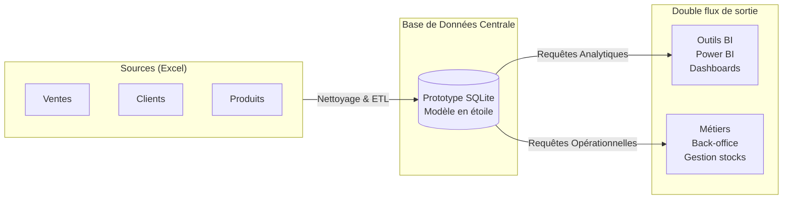
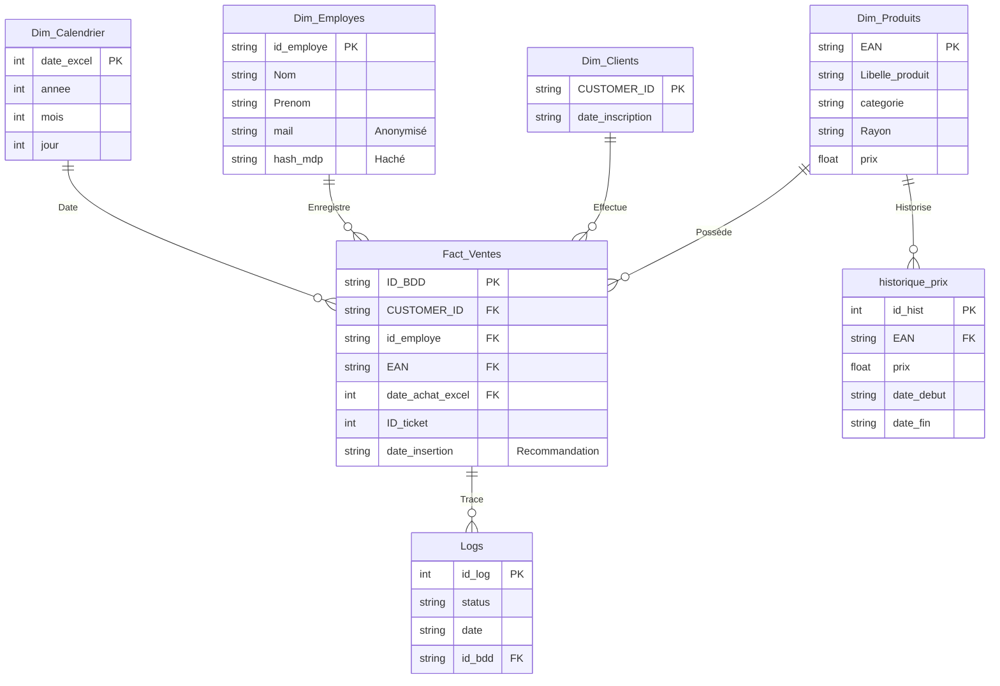

# Ressources Visuelles pour votre Présentation (Canva / PowerPoint)

Ce document contient les schémas et tableaux demandés, recréés au format texte et Mermaid. Vous pouvez utiliser ces codes pour générer automatiquement les schémas, ou vous en inspirer pour les redessiner dans Canva.

---

## 1. Schéma d'Architecture Cible (Slide : L'Architecture de la BDD)

Dans Canva, vous pouvez représenter ce flux avec 3 colonnes de blocs et des flèches :



---

## 2. Diagramme Relationnel / ERD (Slide : Schéma Relationnel)

Voici le schéma relationnel complet (Star Schema) intégrant vos recommandations (Logs et Historique des prix).



---

## 3. Tableaux SQL (Slides : Résultats des Requêtes)

Voici les tableaux avec les données financières que vous pouvez copier-coller pour créer de beaux tableaux graphiques sur Canva.

### A. Le Chiffre d'Affaires du 14 août (CA Consolidé)

> **💡 Note pour le jury (Format de la date Excel) :** 
> Dans les requêtes SQL ci-dessous, vous verrez la valeur `45518`. Il s'agit du format entier d'Excel (le nombre de jours écoulés depuis le 1er janvier 1900). **45518 correspond exactement au 14 août 2024.** *(Le 15 août est donc 45519)*.

**Requête SQL de la démonstration :**
```sql
SELECT 
    date_achat_excel AS Date_Excel, 
    COUNT(ID_ticket) AS Nombre_Ventes, 
    ROUND(SUM(Dim_Produits.prix), 2) AS Chiffre_Affaires 
FROM Fact_Ventes 
JOIN Dim_Produits ON Fact_Ventes.EAN = Dim_Produits.EAN 
WHERE date_achat_excel = 45518;
```

| Indicateur | Valeur validée |
| :--- | :--- |
| **Date Excel** | 45518 (14 août 2024) |
| **Nombre total de ventes** | 41 377 transactions |
| **Chiffre d'affaires arrêté** | **284 243,88 €** |

> *(Format pour Canva : copiez le bloc ci-dessous)*
```text
Indicateur	Valeur validée
Date Excel	45518 (14 août 2024)
Nombre total de ventes	41 377 transactions
Chiffre d'affaires arrêté	284 243,88 €
```

### B. Top Clients et Employés (Exemples de KPIs)

**Requête SQL de la démonstration :**
```sql
SELECT 
    Fact_Ventes.CUSTOMER_ID as Client, 
    COUNT(Fact_Ventes.EAN) as Nb_Achats, 
    ROUND(SUM(Dim_Produits.prix), 2) as CA_Genere 
FROM Fact_Ventes 
JOIN Dim_Produits ON Fact_Ventes.EAN = Dim_Produits.EAN 
GROUP BY Fact_Ventes.CUSTOMER_ID 
ORDER BY CA_Genere DESC 
LIMIT 10;
```

| Rang | CUSTOMER_ID | Nb Achats | CA Généré |
| :---: | :--- | :---: | :--- |
| 1 | CUST-JNSOZSFORR88 | 11 | 846,86 € |
| 2 | CUST-LPOIQW... | ... | 741,20 € |
| ... | *Tous les clients du Top 10* | *Variable* | *Entre 463 € et 846 €* |

> *(Format pour Canva : copiez le bloc ci-dessous)*
```text
Rang	CUSTOMER_ID	Nb Achats	CA Généré
1	CUST-JNSOZSFORR88	11	846,86 €
2	CUST-LPOIQW...	...	741,20 €
...	Tous les clients du Top 10	Variable	Entre 463 € et 846 €
```

---

## 4. Tableaux de Démonstration du Delta (Slides : Audit des Logs)

Ces tableaux sont cruciaux pour démontrer comment vous avez trouvé les +9 057,29 €.

### A. Qualité de l'historique (Modifications de prix)

**Requête SQL de la démonstration :**
```sql
SELECT 
    status, 
    COUNT(*) as Quantite 
FROM Logs 
WHERE status = 'UPDATE' 
GROUP BY status;
```

| Type d'Action (Table Produits) | Quantité | Problème détecté |
| :--- | :---: | :--- |
| **UPDATE** (Prix écrasés) | **575** | Aucune trace du prix précédent. Faussent les calculs de CA dans le passé. |

> *(Format pour Canva : copiez le bloc ci-dessous)*
```text
Type d'Action (Table Produits)	Quantité	Problème détecté
UPDATE (Prix écrasés)	575	Aucune trace du prix précédent. Faussent les calculs de CA dans le passé.
```

### B. Le Delta d'Insertions temporelles

**Requête SQL de la démonstration :**
```sql
SELECT 
    DATE(l.date) as Date_Relle_Enregistrement, 
    v.date_achat_excel, 
    COUNT(v.EAN) as Nb_Mouvements 
FROM Fact_Ventes v
JOIN Logs l ON v.ID_BDD = l.id_bdd
WHERE v.date_achat_excel IN (45518, 45519)
GROUP BY Date_Relle_Enregistrement, v.date_achat_excel;
```

| Date d'Enregistrement réel (BDD) | Date déclarée du Ticket | Nombre de Ventes Insérées | Impact sur le CA du 14 août |
| :--- | :--- | :---: | :--- |
| 14 août 2024 (Matin) | 14 août 2024 | 39 998 | 275 186,59 € |
| **15 août 2024 (Retard)** | **14 août 2024** | **1 379** | **+ 9 057,29 €** |
| | | **TOTAL** | **284 243,88 €** |

> *(Format pour Canva : copiez le bloc ci-dessous)*
```text
Date d'Enregistrement réel (BDD)	Date déclarée du Ticket	Nombre de Ventes Insérées	Impact sur le CA du 14 août
14 août 2024 (Matin)	14 août 2024	39 998	275 186,59 €
15 août 2024 (Retard)	14 août 2024	1 379	+ 9 057,29 €
			TOTAL	284 243,88 €
```

> **Astuce Canva :** Pour le tableau ci-dessus (4.B), utilisez des couleurs (ex: ligne du 15 août en rouge clair ou orange) pour marquer visuellement l'anomalie de synchronisation.
