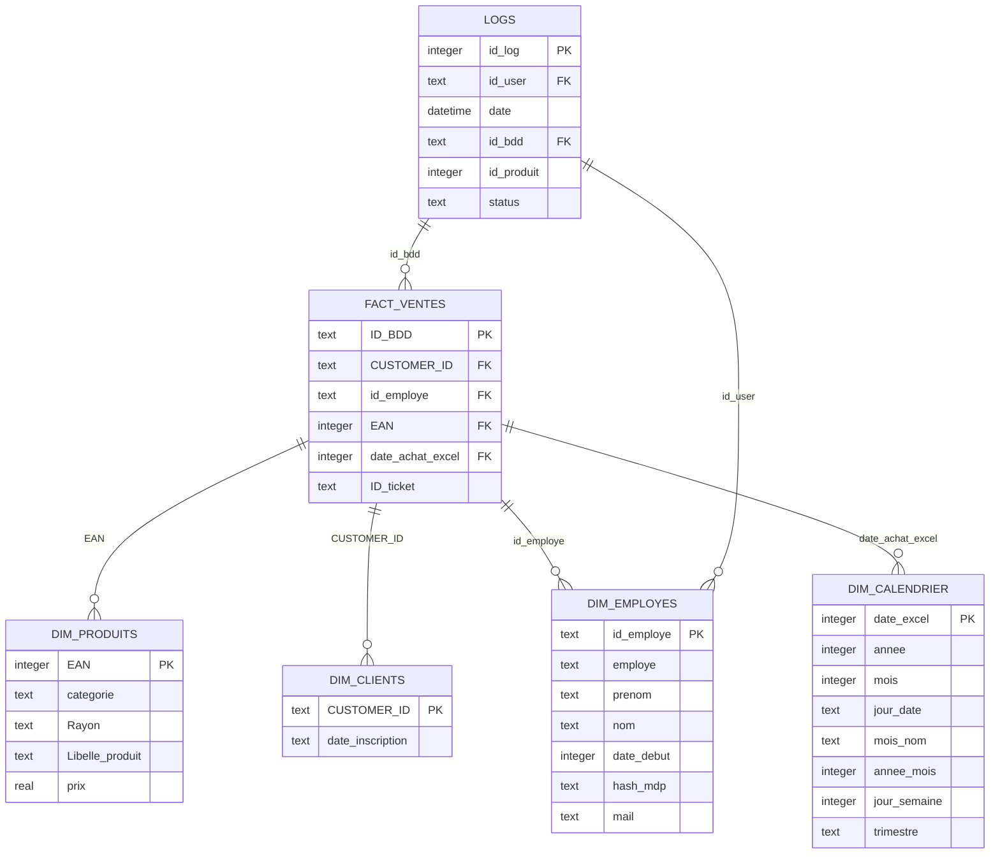

# Schéma Relationnel - Modèle en Étoile (Star Schema)

Voici la modélisation proposée pour le POC SQLite. Ce modèle en étoile optimise les requêtes analytiques demandées par Hugo et intègre la table de traçabilité `Logs` pour l'audit.

---

## Justification du Modèle

### Architecture en Étoile (OLAP)
- **Performance** : La table de fait `Fact_Ventes` est légère (clés et IDs uniquement). Les mesures (le `prix`) sont portées par la dimension `Dim_Produits`, ce qui est conforme au modèle OLAP.
- **Scalabilité** : L'ajout de nouvelles dimensions (ex: une table `Dim_Magasins`) ne nécessite qu'une nouvelle colonne FK dans `Fact_Ventes`.

### Gestion de l'Anomalie Source
- La jointure entre `FACT_VENTES.CUSTOMER_ID` et `DIM_CLIENTS.CUSTOMER_ID` existe malgré la faute `CUSTUMER_ID` dans le fichier Excel source. Cette correction est appliquée **automatiquement** lors du chargement ETL, dans le script `load_data.py`.

### Table `Logs` - Traçabilité
- La table `Logs` est **centrale pour l'audit**. Elle permet de retracer chaque opération (`INSERT`, `UPDATE`, `DELETE`) sur `Fact_Ventes` et d'identifier l'auteur via `id_user` → `Dim_Employes`.
- C'est grâce à cette table que le **delta de 9 057,29 €** sur le CA du 14 août 2024 a pu être expliqué.

### Propriétés ACID Cibles
Chaque ticket de vente (regroupement de lignes par `ID_ticket`) doit être traité de manière **atomique** : soit toutes ses lignes sont enregistrées, soit aucune. La mise en place de transactions SQL garantit cette propriété dans le prototype.
